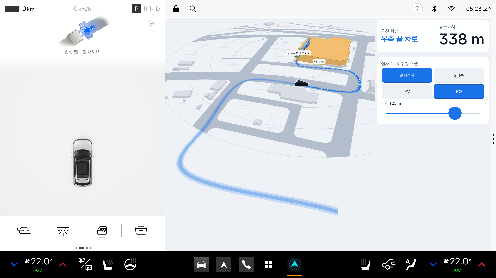
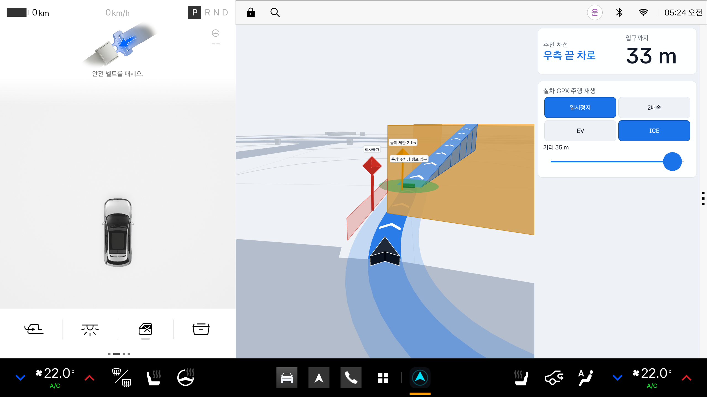

# Tactical Entry Guide — 마이크로 진입로 3D 전술 가이드

순정 내비가 안내를 종료하는 마지막 300m부터 시작되는 단지 내 마이크로 3D 전술 가이드입니다. 대상 시설은 "코스트코 세종점"입니다. 현대자동차그룹 차량용 앱 개발 공모전(Code your App into Pleos App Market) 출품 프로젝트입니다.





- **APK:** [`apk/ambitionandvision_TacticalEntryGuide_release.apk`](apk/ambitionandvision_TacticalEntryGuide_release.apk)
- **시연 영상 (에뮬레이터 화면 녹화):** [실주행 로그 재생 (ICE, 135초)](https://github.com/ambitionandvision/tactical-entry-guide/releases/download/v1.0.0/tactical_entry_guide_ice.mp4) · [시뮬레이션 재생 (EV, 135초)](https://github.com/ambitionandvision/tactical-entry-guide/releases/download/v1.0.0/tactical_entry_guide_ev.mp4) — [Release v1.0.0](https://github.com/ambitionandvision/tactical-entry-guide/releases/tag/v1.0.0)
- **화면 캡처:** [`docs/screens/`](docs/screens/)

## 1. 앱 이름 및 한 줄 소개

- **앱 이름:** Tactical Entry Guide
- **한 줄 소개:** 목적지 300m 전부터 높이 제한·회차불가·대기차로 같은 현장 위험요소와 연료 타입(EV/내연기관)별 맞춤 입구를 3D 로 안내합니다. 패키지명은 `io.github.ambitionandvision.tactical` 입니다.

## 2. 실행 방법

사전 준비: Windows 에 JDK 17, Android SDK, Pleos 에뮬레이터 이미지가 필요합니다. WSL(Ubuntu) 또는 Git-Bash 에서 아래를 실행합니다.

```bash
# 1) local.properties(SDK 경로) 자동 생성
bash scripts/setup_local_properties.sh

# 2) release APK 빌드 + apk/ 로 복사. 파일명의 팀명 자리 기본값은 ambitionandvision (GitHub 계정명)
bash scripts/build_release_apk.sh                         # 다른 이름을 쓰려면 TEAM_NAME=이름 을 앞에 붙입니다

# 3) 에뮬레이터 부팅 → 설치 → 실행 (Windows 는 scripts\run_emulator_demo.bat)
bash scripts/run_emulator_demo.sh                        # 앱 내장 GPX 재생 사용
bash scripts/run_emulator_demo.sh --fuel EV              # 연료 타입 지정(ICE|EV). 미지정이면 앱이 판별(에뮬레이터는 EV)
bash scripts/run_emulator_demo.sh --inject               # 앱을 source=fused 로 실행하고 GPX 를 adb emu geo fix 로 1Hz 주입
bash scripts/run_emulator_demo.sh --drive-gpx            # Driving View 속도를 GPX <speed> 에 맞춤(종료 시 Park 복귀)

# 4) 원클릭 시연 녹화 (Windows 는 scripts\record_demo.bat)
bash scripts/record_demo.sh --fuel ICE --secs 135        # docs/demo/tactical_entry_guide_ice.mp4 (기본 6Mbps)
bash scripts/record_demo.sh --fuel EV --secs 135         # docs/demo/tactical_entry_guide_ev.mp4
```

Gradle 은 `bash scripts/gradle_win.sh <task>` 로 실행합니다(예: `testDebugUnitTest`). 이 스크립트는 Windows JDK 17 로 Gradle Wrapper 8.10.2 를 호출합니다. 앱 안에서는 재생/일시정지, 2배속, 거리 슬라이더(500~0m), EV/ICE 전환을 데모 컨트롤 바로 조작합니다.

차선 이탈 경고 시연은 화면 버튼이 아니라 실행 인자로 켭니다(재생 시작 N 초 뒤 5초간, `--es fuel ICE|EV` 와 함께 씁니다):

```bash
adb shell am start --user 10 -n io.github.ambitionandvision.tactical/.MainActivity --es fuel ICE --ei laneTestAtSec 38
```

화면은 밝은 테마입니다(밝은 회백색 바탕, 흰 카드, 파란 강조색, 주황색 본관, 파란 유도 리본과 램프). 실제 Pleos 화면과 어울리게 한 것이며, 시스템이 야간 모드이면 어두운 색을 씁니다(야간은 에뮬레이터에서 확인하지 않았습니다). 글꼴은 앱에 넣지 않고 시스템 기본 글꼴(Pleos Connect 에뮬레이터에서는 Asta Sans)을 씁니다. Phase 2 HUD 에는 추천 차선, 입구까지 거리, 차선 이탈 경고만 있고, 높이 제한·회차불가·대기차로는 3D 지도 위의 핀과 라벨, Phase 1 요약 카드의 현장 주의와 높이 제한 배지로 보여 줍니다.

**설치 주의:** release APK 는 빌드한 PC 의 디버그 키로 서명됩니다. 다른 PC 에서 빌드한 APK 가 이미 설치돼 있으면 `install -r` 이 서명 불일치(`INSTALL_FAILED_UPDATE_INCOMPATIBLE`)로 실패합니다. 먼저 `adb uninstall io.github.ambitionandvision.tactical` 을 실행합니다.

## 3. 테스트 환경 및 필요한 설정

### 개발에 사용한 Pleos Connect 에뮬레이터 버전과 화면 규격

| 항목 | 값 |
|---|---|
| 에뮬레이터 이미지 | 공식 `system-images;android-34;pleos_car_emulator;x86_64` — **Pleos Connect v2.1.0**, Android 14 (API 34) |
| 화면 | **2560×1440, 160dpi**, landscape, Cold boot |
| 앱 창 크기 | landscape(2창) 1682×1210dp, portrait(1창) 841×1210dp. 왼쪽 Driving View 853px 고정 |
| 확인한 날 | 2026-11-14, 2026-11-05 |

### 빌드·실행 환경


- 빌드: Gradle 8.10.2, AGP 8.8.2, Kotlin 2.0.0, JDK 17, compileSdk/targetSdk 34, minSdk 29 (설정 값은 `android_pleos_app/build.gradle.kts` 기준).
- 에뮬레이터: 공식 이미지 `system-images;android-34;pleos_car_emulator;x86_64`(Pleos Connect v2.1.0, 약 19GB), AVD 이름 `Pleos_Connect_API34`.
  - 이미지가 없으면 Android Studio > SDK Update Sites 에 공식 URL 을 추가해 설치하거나, `bash scripts/run_emulator_demo.sh --install-image` 로 공식 매니페스트 zip(`https://nexus-playground.pleos.ai/repository/raw-releases/connect-avd/2.x/crp_car_emulator.zip`, 약 4.09GB, SHA-1 `b4f858d5bcc6c71506d7edfc872bcb9e5a11acaa`)을 받아 검증·압축해제합니다(디스크 여유 25GB 이상 필요, 42dot SDK License 동의로 간주). 최근 `sdkmanager` 는 커스텀 사이트를 인식하지 못했습니다.
  - `avdmanager` 가 이미지를 인식하려면 이미지 폴더에 `package.xml` 이 필요합니다(`--install-image` 가 작성합니다).
  - `avdmanager create avd` 기본값(320x640, RAM 2G, fast boot)은 쓰지 않습니다. 스크립트가 `config.ini` 를 `hw.lcd.width=2560 hw.lcd.height=1440 hw.lcd.density=160 hw.initialOrientation=landscape hw.ramSize=4096 hw.gpu.enabled=yes hw.gpu.mode=host hw.keyboard=yes fastboot.forceColdBoot=yes fastboot.forceFastBoot=no hw.cpu.ncore=6 hw.gps=yes disk.dataPartition.size=12G` 로 덮어씁니다. **Cold boot 가 필수입니다**(Quick boot 시 VHAL 사용 불가).
  - 실행 인자는 `emulator -avd Pleos_Connect_API34 -no-snapshot-load -gpu host` 이고, 부팅에 약 77초가 걸립니다. 이미 실행 중이면 재사용합니다.
  - `user` 빌드라 `adb root`, `cmd car_service emulate-driving-state` 는 쓸 수 없습니다. 앱은 사용자 10(`u10`)에서 돌므로 설치·실행·권한 부여에 `--user 10` 을 씁니다.
  - 앱 영역: 왼쪽 Driving View 853px 고정, 오른쪽 앱 창 1682×1210dp(landscape 2창, 밀도 160).
  - 주행 재현: Virtual Console HTTP API(`adb forward tcp:8088 tcp:8088`, 브라우저 세션 하트비트 1초 필요). `python3 scripts/virtual_console_drive.py --gear Drive --speed 25 --hold 60 --watch-uxr` 가 기어·속도를 설정하고 UxR 을 출력하며 종료 시 항상 Park 으로 복귀합니다. 실측: Drive + 25km/h 에서 `DO: true UxR: 80`(NO_VIDEO+NO_SETUP), Park 복귀 시 `DO: false UxR: 0`. `run_emulator_demo` 의 `--drive` 로도 연결됩니다. WSL 에서는 adb forward 가 Windows localhost 에만 열려 Windows `python.exe` 로 자동 재실행합니다.
- Pleos SDK 는 `https://nexus-playground.pleos.ai/repository/maven-releases/` 에서 받습니다(인증 불필요). SDK 라이선스상 AAR 은 저장소에 포함하지 않습니다.
- 권한: `pleos.car.permission.FUSED_LOCATION`(런타임 요청), `CAR_ENERGY`, `NAVI_ROUTE`. 개발 단계에서는 매니페스트 선언만으로 쓰고, App Market 배포 때 심사에서 승인된 권한만 허용됩니다(공식 온라인 설명회 안내).
- 공모전 개발 환경 요구(공식 온라인 설명회 안내: Android API 28 이상, Gradle 8.0 이상)를 충족합니다.
- 단위 테스트(2026-11-14): `bash scripts/gradle_win.sh testDebugUnitTest` → 134개 중 통과 133, 실패 0, 건너뜀 1(개발용 미리보기 출력 테스트, 의도된 건너뜀).
- `local.properties`, `gradle.properties` 의 `org.gradle.java.home` 는 개발 PC 경로입니다. 다른 PC 에서는 `bash scripts/setup_local_properties.sh --jdk <JDK17 경로>` 로 맞춥니다.

### 데이터 출처와 시뮬레이션 고지

- **지도 데이터:** 국토지리정보원 수치지도(도엽 36710011, 2025)를 로컬 좌표(원점 36.467786, 127.269966, 반경 300m)로 변환했습니다. 원점은 주차장 입구(`MAIN_PARKING`, 옥상 주차장 램프의 오르막 시작점)이며 2026-11-13 실주행 로그로 정했습니다.
- **현장 확인(2026-11-13):** 램프 입구에 차단기·발권기가 없고, 높이 제한 표지는 2.1m 입니다. 앱은 이 값을 정적 배지로만 보여 주고 차량 데이터와 비교하지 않습니다.
- **회차불가·대기차로 핀의 위치와 EV 경로는 저작 데이터이며 현장 확인이 필요합니다.** 높이 제한 핀도 좌표는 측량하지 않았습니다. 세 핀 모두 `fieldVerified:false` 입니다.
- **주 경로 GPX(`gis_data/sejong_costco_cn8_drive.gpx`)는 실주행 로그입니다.** 2026-11-13 아반떼 CN8 가솔린으로 주행하며 스마트폰 GPS 로거(1Hz)로 기록했습니다(115점, 114초, 입구 386m 지점부터). 메타데이터는 `real-drive` 이고 앱에는 "실차 GPX 주행 재생" 으로 보입니다. 차량 GNSS 측위가 아니라 스마트폰 기록입니다. 처리 내역은 `docs/real_drive_report_main.md` 에 있습니다.
- **EV 경로 GPX(`gis_data/sejong_costco_ev_drive.gpx`)는 실주행 기록이 아니라 합성한 시뮬레이션입니다.** 메타데이터에 `simulated` 가 표시되고 앱에는 "GPX 주행 재생 (시뮬레이션)" 으로 보입니다.
- **검증 범위:** 합성 궤적 재생과 실주행 로그 재생은 에뮬레이터의 앱에서 수행했습니다. 앱을 차량에 설치해 돌리는 실차 탑재 검증은 아직 수행하지 않았습니다.
- 본관 건물은 수치지도 외곽선을 돌출한 단순 모델(높이 14.0m)이고, 진입 램프(`RAMP_MAIN`)만 따로 3D 로 표현합니다. 램프 형상은 실주행 로그의 위치·고도를 쓴 근사입니다.
- 전기차 충전: 본관 남동측의 지상 충전소는 실제로 있습니다(2026-11-13 방문 기억). 옥상에도 충전기가 몇 기 있으나 위치는 알지 못합니다. 앱은 EV·PHEV 를 지상 충전소 쪽 입구로만 안내합니다.

### 시연 영상과 화면 캡처 (2026-11-14, 개발 PC 의 Pleos 에뮬레이터)

| 파일 | 길이 | 크기 | 차량 이동 | 앱 화면 라벨 |
|---|---|---|---|---|
| [`tactical_entry_guide_ice.mp4`](https://github.com/ambitionandvision/tactical-entry-guide/releases/download/v1.0.0/tactical_entry_guide_ice.mp4) | 135.0초 | 79,768,810 바이트 (약 76MB) | **실주행 로그 재생** | "실차 GPX 주행 재생" |
| [`tactical_entry_guide_ev.mp4`](https://github.com/ambitionandvision/tactical-entry-guide/releases/download/v1.0.0/tactical_entry_guide_ev.mp4) | 135.0초 | 66,598,057 바이트 (약 64MB) | **합성 시뮬레이션** | "GPX 주행 재생 (시뮬레이션)" |

- 둘 다 에뮬레이터 화면 녹화입니다(1920x1080 h264, 6Mbps). 편집·자막 없는 연속 녹화이고, Driving View 속도는 GPX 속도를 Virtual Console 로 따라갑니다.
- 녹화 명령: `bash scripts/record_demo.sh --fuel ICE --secs 135` (Windows: `scripts\record_demo.bat --fuel ICE`, 기본 135초·6Mbps). 녹화 후 앱 로그로 재생 시작 1회·도착 1회·조작 0회를 검사합니다.
- **영상 위치:** 두 영상은 저장소 본문이 아니라 [GitHub Release v1.0.0](https://github.com/ambitionandvision/tactical-entry-guide/releases/tag/v1.0.0) 에 올렸습니다. 직접 녹화하면 `docs/demo/` 에 같은 이름으로 생기며, 이 폴더의 mp4 는 `.gitignore` 로 제외돼 있습니다.
- 화면 캡처 9개(`docs/screens/`, 2560x1440): `phase1_summary_landscape.png`, `phase1_summary_portrait.png`, `phase2_tactical_landscape.png`, `phase2_ramp_approach_landscape.png`, `phase2_driving_restricted_D.png`, `phase2_offroute_warning_landscape.png`, `phase2_offroute_warning_portrait.png`, `phase3_arrived_landscape.png`, `phase3_arrived_portrait.png`.
- 화면의 "입구까지" 는 유도선을 따라 남은 거리이고, 데모 바의 "거리" 는 직선거리입니다.

### 실주행 로그로 교체

스마트폰 GPS 로거 등으로 기록한 GPX 를 넣습니다. 교체 후 앱 라벨이 자동으로 "실차 GPX 주행 재생" 으로 바뀝니다.

```bash
python3 scripts/import_real_gpx.py --main 주차장입구.gpx --dry-run   # 검사만
python3 scripts/import_real_gpx.py --main 주차장입구.gpx --ev 충전소입구.gpx
python3 scripts/import_real_gpx.py --restore all                     # 시뮬레이션 GPX 로 복원
```

- 도착 기준으로 구간을 잘라 집 등 구간 밖 위치를 제거하고, 작성자·기기·계정 메타데이터를 버리고, 1Hz 로 정규화합니다. 원본 파일은 저장소에 넣지 않습니다.
- Phase 전이·유도선 흡착·이탈 경고를 미리 계산해 `docs/real_drive_report_*.md` 로 남깁니다.
- 궤적이 입구에 닿지 않으면 교체를 거부하고 `extract_shp_to_tactical.py --origin` 명령을 안내합니다. 입구 좌표를 먼저 고친 뒤 다시 실행합니다.
- 교체한 실주행 로그는 `extract_shp_to_tactical.py` 를 다시 돌려도 덮어쓰이지 않습니다.
- 기록 장치가 스마트폰이면 차량 GNSS 측위가 아닙니다. 기획서에도 기록 장치를 그대로 적습니다.

## 4. APK 위치

`apk/ambitionandvision_TacticalEntryGuide_release.apk` (`scripts/build_release_apk.sh` 가 생성합니다). 디버그 키로 서명한 실행 가능한 release 빌드입니다. 공모전 규격 `팀명_앱이름_release.apk` 의 팀명 자리에는 개인 참가라서 GitHub 계정명을 썼습니다.

현재 들어 있는 파일(2026-11-14 빌드):

- `apk/ambitionandvision_TacticalEntryGuide_release.apk`, 8,931,797 바이트
- 패키지명 `io.github.ambitionandvision.tactical`, versionCode 1, versionName 1.0.0
- SHA-256 `9d008c570089c5772d8d1383560fbb2bf156d64b7dd9d93af4166f6754d7030a`
- APK 서명 v2, 디버그 키(`CN=Android Debug`), 인증서 SHA-256 `c225eb2eb2288bcfbc0f53d16bf67fcda9a1cbfa63f1df7574327becf62a111b`
- 같은 APK 를 [GitHub Release v1.0.0](https://github.com/ambitionandvision/tactical-entry-guide/releases/tag/v1.0.0) 에 올렸습니다.

## 저장소 구성

| 경로 | 내용 |
|---|---|
| `android_pleos_app/` | Android 앱(Kotlin) |
| `unity_tactical_module/` | Unity 3D 모듈(선택 경로, 없으면 Canvas 폴백 뷰) |
| `gis_data/`, `scripts/` | Zone 데이터와 GIS 변환·Blender 동기화·빌드·시연 스크립트 |
| `docs/` | 기술 규격, 시연 대본, Blender 가이드, 실주행 로그 처리 보고서, 화면 캡처 |
| `apk/` | 제출용 APK |

## 문서

- [`docs/SPEC.md`](docs/SPEC.md): 좌표 수식, Zone JSON·OBJ·GPX 규격, 모듈 경계, 사용한 Pleos SDK API. 코드 주석의 `TEAM_WORKSPACE N.N` 은 이 문서의 같은 번호 절입니다.
- [`docs/DEMO_SCRIPT.md`](docs/DEMO_SCRIPT.md): 시연 영상의 화면 순서와 재현 방법.
- [`docs/BLENDER_WORKFLOW_GUIDE.md`](docs/BLENDER_WORKFLOW_GUIDE.md): 유도선·핀을 Blender 에서 고쳐 앱에 반영하는 절차.
- [`docs/real_drive_report_main.md`](docs/real_drive_report_main.md): 실주행 로그를 앱 데이터로 바꾼 처리 내역.

지도 원본(SHP)은 저장소에 넣지 않았습니다. `scripts/extract_shp_to_tactical.py` 로 지도를 다시 만들려면 국토지리정보원 수치지도를 `source_shp/` 에 따로 준비해야 합니다.
